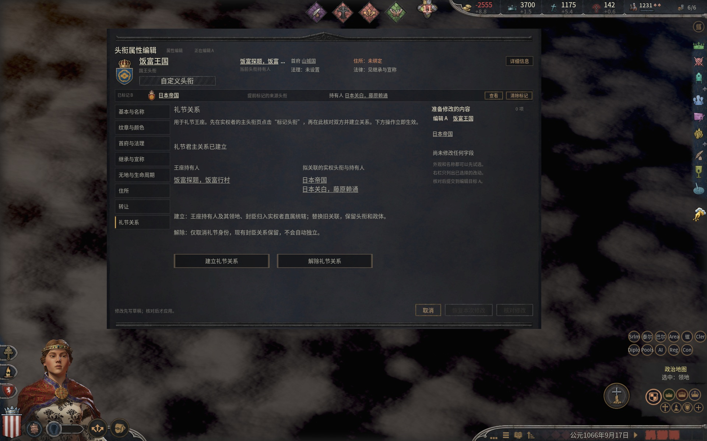
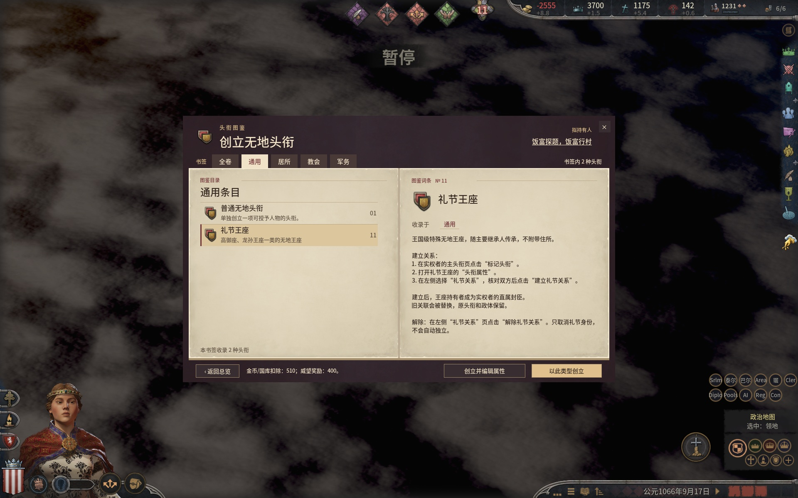

# 节制天下兵马：无地头衔管理器

右键人物，在「领地」分栏选择**「无地头衔管理（天下兵马）」**，即可打开同时支持有地头衔和无地头衔的管理菜单。你可以为自己或其他人物自由创立无地头衔，也可以编辑已有头衔的属性、调整法理归属、改变法理首都、迁移住所位置、授予已标记的头衔，或从现任持有人手中剥夺所选头衔。

## 更新公告｜2026年11月17日

- **修复骑士团与修会头衔的政体设置**　针对非统治者建团时可能出现的封建制问题，补齐新团长的政体设置：创建军事骑士团后使用骑士团政体，创建普通修会后使用修会政体。已有统治者兼领时保留原政体；已测封建、部落、行政、冒险者及公爵级以上游牧样本通过。
- **新增礼节王座**　在「创立无地头衔」图鉴的「通用」分类中，可以创立高御座、龙孙王座一类的王国级无地王座。王座随主要继承人传承，不附带住所。
- **新增礼节关系分页**　打开王座的「头衔属性」，在编辑器**左侧竖排、「转让」下方**选择「礼节关系」，即可在同一页建立或解除礼节君主关系。先标记实权者的主头衔，再打开王座核对双方并建立关系；图鉴页也已补充操作说明。
- **补充原版头衔自定义入口**　可从属性编辑器打开原版自定义窗口，编辑名称、形容词、纹章和地图颜色。此入口沿用原版权限，其他头衔仍可使用已有属性分页。

建立礼节关系后，王座持有人会成为实权者的直属封臣，原有礼节关联被替换，并保留原头衔与政体。解除只取消礼节身份，现有封臣关系保留，不会自动独立。已测场景通过建立、解除、过日和保存读档检查。

**已知问题：**伯爵级游牧统治者取得公爵级骑士团头衔后，仍可能转为骑士团政体，暂列为已知缺陷。此次更新不会自动修复旧存档中已经发生的政体变化。

## 更新实机截图

## 自定义住所头衔
本 Mod 新增了可以绑定游戏原生住所的**动态住所头衔**。在「创立无地头衔」图鉴中，你可以为新头衔选择**伯爵、公爵、国王、皇帝或霸权**位阶，再指定绑定的住所。

你可以按自己的政体，手选要绑定的游戏原生住所。图鉴提供家族庄园、东亚庄园、日本庄园、教会庄园、营地和游牧首都（毡帐）。选定的住所随新头衔一同创建，并绑定在该头衔上。

## 创立图鉴中的专有头衔
图鉴分别展示各类头衔的用途、创立条件，以及建成后实际获得的住所、辖区或组织。只启用本 Mod，就可以创立以下头衔。

- **冒险者头衔和游牧头衔**　两种都能从伯爵级建到霸权级。冒险者头衔附带营地，游牧头衔附带毡帐。已有封地的领主也可以兼领这两类头衔，并保有原来的政体。
- **教区头衔**　可以建立有实际辖县的教区。你可以提前标记伯爵领或男爵领来指定地点，也可以从拟持有人首府所在的教区尝试分设新教区。
- **宗教领袖头衔和枢机头衔**　可以为拟持有人的信仰设立宗教领袖，也可以在设有教会选举人的信仰增设枢机席位。信仰已有领袖时，改立须再次确认。天主教封建领主获任宗教领袖后，实测会转为教会制，领地法律也随之改变。
- **修会和军事修会头衔**　你可以创立新的隐修会或军事修会，让自己的角色或指定人物持有新修会的领袖头衔。新修会有自己的组织和租用的驻地。你也可以提前标记一处符合条件的男爵领作为驻地。

普通无地头衔可选公爵、国王、皇帝和霸权四档。创立普通无地头衔或带住所的头衔时，若新位阶高于现有主头衔，图鉴会提示新头衔将升为主头衔，并请你再次确认。

**佣兵团头衔暂未开放新建。** 当前游戏提供给 Mod 的脚本接口无法即时创建原生佣兵团并交付其特殊头衔。若想取得已有的佣兵团头衔，可以右键现任团长，在管理菜单中选中该头衔，使用「剥夺所选头衔」。

## 已有头衔的管理

- **授予和剥夺无地头衔**　本作解除原版授予和剥夺普通无地头衔的限制。要转授，先标记头衔，再右键接收人，选择「授予已标记头衔」。要收归自己，右键现任持有人，选中该头衔并选择「剥夺所选头衔」。绑定住所的头衔、家族身份头衔和游牧身份头衔仍受保护。
- **法理、住所与继承**　可以调整法理上级、指定头衔的法理首府，或将标记头衔名下的实际住所迁往所选地点。属性编辑器还可为单个头衔设置适用的继承法、调整自动宣称与继承时的销毁规则。原生及来源不明的住所头衔受禁毁保护。

## 推荐一起订阅《住所庄园管理大师》
你可以根据头衔的特性，搭配其他 Mod 扩展玩法。例如，用本作创立几个带住所的头衔之后，可以通过[《住所庄园管理大师》](https://steamcommunity.com/sharedfiles/filedetails/?id=3819185353)的「管理所有住所」决议逐座管理和建设住所，交换本人同类住所的建筑，或分别汇集辅助营地的给养与辅助毡帐的牧群。两款 Mod 可以各自单独启用。

头衔管理器 0.4.4 与住所庄园管理大师 1.2.1 共用同一份头衔详情页。这两个版本搭配使用时，页面同时提供本作的标记图钉和大师按条件显示的住所按钮。创立住所时，本作图鉴由玩家手选住所，大师的「创建住所头衔」决议按使用者本人的政体生成相应住所。

## 反馈与交流
欢迎加入**ck3节制天下兵马系列mod反馈群**，交流玩法、反馈问题和提出建议。

**QQ群号：108936531**

反馈问题时，可以附上游戏版本、启用的模组列表、复现步骤和截图，方便定位。

## 作品来源与链接
本作的头衔管理互动拆分自我制作的《节制天下兵马：军政分离与协防体系》。部分建衔和法理脚本参考了 Ritual Article 的《简单领地管理》。创立图鉴和分页属性编辑器的界面由我的「观窗」工程制作。[军政分离与协防体系](https://steamcommunity.com/sharedfiles/filedetails/?id=3729043634) · [简单领地管理（Simple Manager - Realm）](https://steamcommunity.com/sharedfiles/filedetails/?id=3394034138) · [观窗 GitHub](https://github.com/apo-so/guanchuang)

按具体头衔打开住所，沿用了我在《住所庄园管理大师》中的做法。游牧头衔的政体保护参考了《亳伯奇难题》和《动态无地伯爵》。军事修会的建团与驻地租赁沿用了《兼领军事修会》的办法。[亳伯奇难题](https://steamcommunity.com/sharedfiles/filedetails/?id=3805560229) · [动态无地伯爵](https://steamcommunity.com/sharedfiles/filedetails/?id=3803270674) · [兼领军事修会](https://steamcommunity.com/sharedfiles/filedetails/?id=3760462875)

[我的 CK3 自制 Mod](https://steamcommunity.com/profiles/76561198854290129/myworkshopfiles/?appid=1158310)　·　[无地头衔管理器 GitHub](https://github.com/apo-so/ck3-landless-title-manager)

**版本 0.4.6-test5（测试版）｜CK3 1.20.1.2｜简体中文**

## 下载与安装

当前测试版：[**0.4.6-test5 下载与更新说明**](https://github.com/apo-so/ck3-landless-title-manager/releases/tag/v0.4.6-test5)。下载 `01wuditouxianguanliqi-v0.4.6-test5.zip`，将其中的 `01wuditouxianguanliqi` 文件夹和同名 `.mod` 文件解压到 CK3 用户目录的 `mod` 文件夹，在启动器中启用本 Mod 后完整启动游戏。
